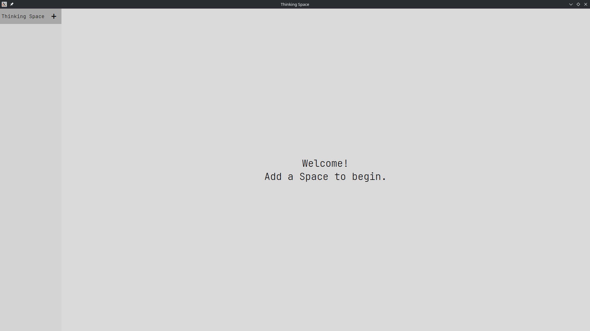
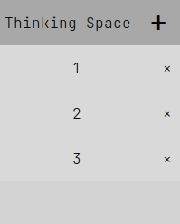
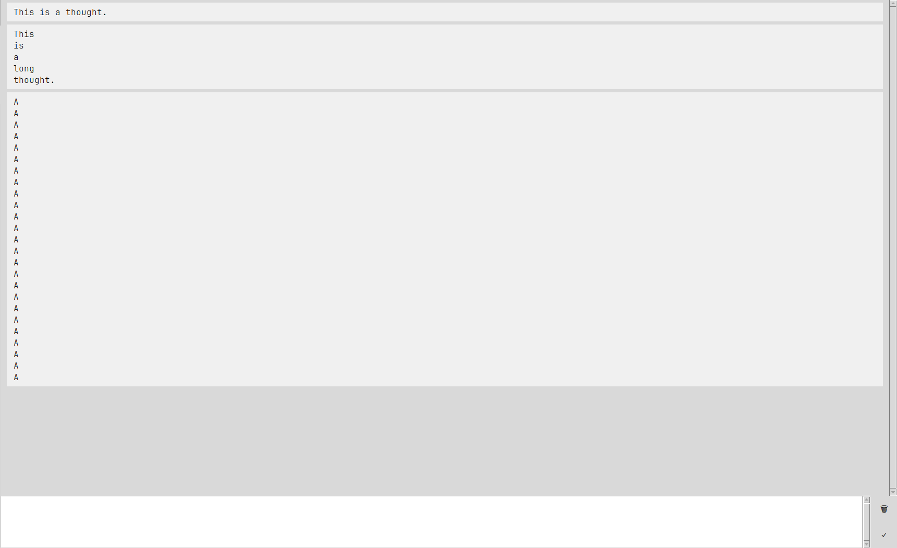
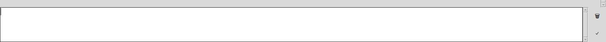

# Thinking Space

### Tkinking Space is a cross-platform desktop application, that lets you write own your deepest thoughts that you've been having throughout the day.

### This app features easy "Space" creation/deletion and switching. They appear in the menu bar on the left side:

### In these Spaces, you write "Thoughts" (or messages, call it whatever you want). They are shown in the Thought's area on the right:

### You write your Thoughts in the text bar below, confirm the text you wrote with Ctrl + Enter or with the button on the bottom-right:

## Upcoming implementations:
### Thought deletion, Space naming, dark mode.