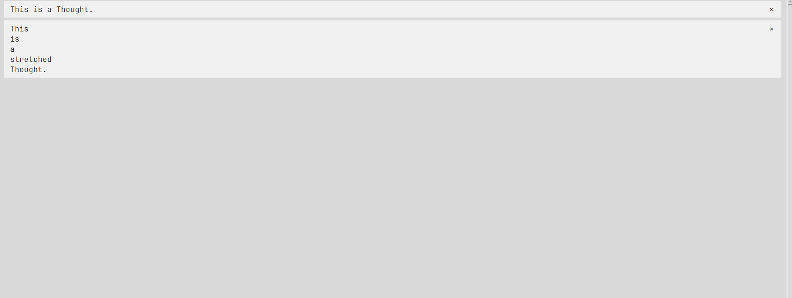

# Thinking Space

### Tkinking Space is a cross-platform desktop application, that lets you write own your deepest thoughts that you've been having throughout the day.

### This app features easy "Space" creation/deletion and switching. They appear in the menu bar on the left side:

### In these Spaces, you write "Thoughts" (or messages, call it whatever you want). They are shown in the Thought's area on the right:

### You write your Thoughts in the text bar below, confirm the text you wrote with Ctrl + Enter or with the button on the bottom-right:

## Upcoming implementations:
### Space naming, dark mode.

# Octber 25: New feature!
## Thought deletion
### You're now able to delete Thoughts you wrote down with a button at the right side 

# October 26: New feature! (a hour later)
## Resiable menu
### The menu is now resizable

# HOW TO USE
## Spaces
### There's a bar on the left of the window with a + button on top. That button adds a Spaces ("chats") below. The Spaces can be delete with the X buttons.
## Thoughts
### By clicking the Space, it opens an area on the right, where Thoughts ("messages") can be written. You write them in the text bar below. Press the button with the checkmark to send it or press Ctrl + Enter. The Thoughts can also be deleted with the X buttons.
